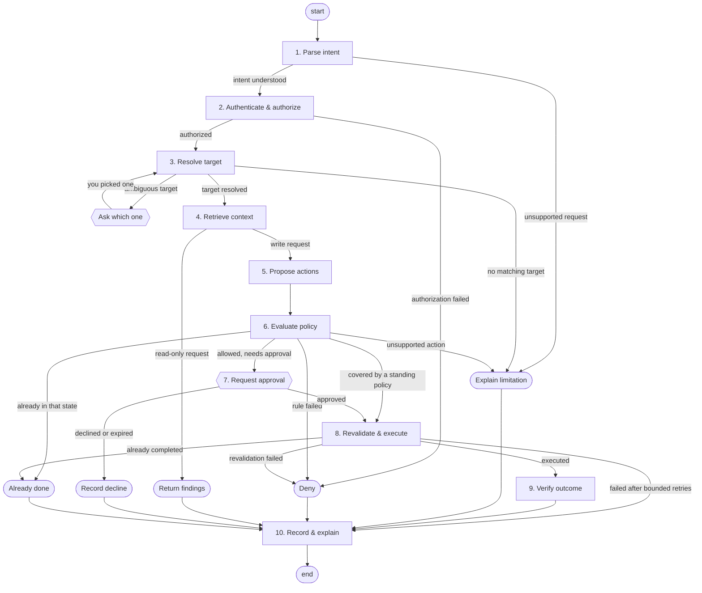

# NEARAuth agent service

A LangGraph.js workflow engine that turns requests like *"Stop this third party from emailing me"* into a planned, policy-checked, human-approved, verified and audited action. The dashboard's **Privacy Assistant** is its UI.

**Status:** first vertical slice. Simulation (mock provider) is the default; real SimpleLogin execution is opt-in, loopback-only, and has been exercised only against a local mock of the SimpleLogin API. See *Limitations*.

## Run it (no accounts, no paid AI)

```bash
cd agent
npm install
npm run demo          # embedded Postgres (PGlite + pgvector), mock provider, demo data; prints a session token
# in another terminal, from the repo root:
npm run serve         # http://localhost:8080/#assistant  → paste the token → Connect
```

Other ways to run:

| Goal | Command |
|---|---|
| Real Postgres + pgvector in Docker | `docker compose -f agent/docker-compose.yml up --build`, then `docker compose -f agent/docker-compose.yml exec agent npx tsx src/cli/pair.ts --user demo --seed-demo` |
| Your own Postgres | `DATABASE_URL=postgresql://… npm start`, then `npm run pair -- --user you` |
| Local model (optional) | install [Ollama](https://ollama.com), `ollama pull llama3.2:3b`, then `NEARAUTH_LLM=ollama npm run demo`. If Ollama is down the agent keeps working on rules. |
| Real SimpleLogin (opt-in) | `NEARAUTH_PROVIDER=simplelogin SIMPLELOGIN_API_KEY=… npm start` — only binds to 127.0.0.1; then sync aliases from the dashboard |
| Tests | `npm run typecheck && npm test` (26 tests, embedded Postgres, no network) |
| Graph as Mermaid | `npm run graph` |
| Retrieval evaluation | `npm run eval:retrieval` → [docs/agent/RETRIEVAL_EVAL.md](../docs/agent/RETRIEVAL_EVAL.md) |

## The graph



The node and edge lists live in `src/graph/spec.ts`; `src/graph/graph.ts` wires LangGraph from the same names, and `GET /v1/graph` serves them to the dashboard, which highlights the executed path of each workflow.

## How a write is kept safe

| Step | Mechanism | Code |
|---|---|---|
| Understand | rules first; optional Ollama may only return `{ "intent": <enum> }` (strict schema) | `intents.ts`, `llm.ts` |
| Target | exact relational lookup; vectors only suggest, the user picks | `graph.ts` › `resolve_target` |
| Decide | deterministic rules P1–P12, no model involved | `policy.ts` |
| Approve | HMAC-bound to `(id, user, thread, proposal, action hash, expiry)`, single use, client must echo the hash | `approvals.ts` |
| Execute | consume approval → re-read provider → re-run policy → mint an in-process grant → one scoped tool | `graph.ts` › `revalidate_execute`, `tools/registry.ts` |
| No duplicates | receipt keyed by idempotency key; adapters *set* state (read-then-write) even over toggle APIs; only transient errors retried, max 3 | `tools/index.ts`, `providers/` |
| Verify | re-read provider; `requested` ≠ `verified` ≠ `failed` | `verify_action` |
| Record | sanitized receipt (masked alias), local SHA-256 audit commitment compatible with `extension/lib/merkle.js`; never described as on-chain | `audit.ts` |
| Isolate | Postgres `FORCE ROW LEVEL SECURITY` + per-transaction `SET LOCAL ROLE nearauth_app` / `app.user_id` | `db/migrations/001_core.sql`, `db/pool.ts` |

## API

Bearer session tokens (issued by `npm run pair`, stored as SHA-256), JSON only, 64 KB limit, origin allow-list, no cookies.

`GET /v1/health` · `GET /v1/graph` · `GET /v1/me` · `GET /v1/aliases` · `POST /v1/sync` · `POST /v1/workflows` · `GET /v1/workflows[/:id]` · `POST /v1/workflows/:id/decision|target|cancel|recover` · `GET /v1/approvals` · `GET /v1/history` · `POST /v1/receipts/:id/undo` · `GET|POST|DELETE /v1/policies` · `GET|POST|DELETE /v1/memory` · `GET|PATCH /v1/settings` · `DELETE /v1/history` · `GET /v1/audit`

## Free deployment options and their limits

- **Your own machine (recommended):** `npm run demo` or Docker Compose. Free; the dashboard on GitHub Pages can call `http://127.0.0.1:8787` from the same machine.
- **GitHub Pages cannot run it** (static hosting only).
- Free container hosts and free Postgres tiers exist but typically sleep when idle, cap storage, and may not offer pgvector; check current terms before relying on one. Real-provider mode is deliberately refused on non-loopback hosts. No paid service is configured here.

## Limitations (honest list)

- Inbound mail is not processed: sender data comes from provider metadata (SimpleLogin contacts) or the demo seed. A true RFC 8058 unsubscribe is therefore always **unsupported**; the agent offers blocking instead.
- Real SimpleLogin execution is single-tenant (one key per agent process) and verified only against a local mock server.
- Provider keys in the *extension* are still stored unencrypted (see `docs/agent/THREAT_MODEL.md` R1); the agent never receives them.
- Re-authentication for high-risk approvals means issuing a fresh session token from the CLI; there is no in-browser re-auth flow yet.
- The hash embedder is spelling-level only; meaning-level matching needs a local embedding model (not evaluated here).
- MCP exposure and delegated capabilities for external agents are not implemented.
